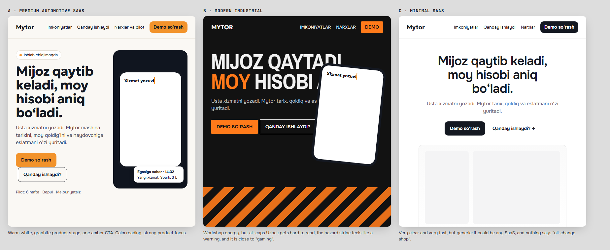

# Mytor redesign: concepts, selected direction and design tokens

`docs/concepts/board.html` renders the same hero copy in all three directions (exploration only; it is not part of the build).

## Concept comparison

Scores run from 1 (weak) to 5 (strong), judged from the rendered board and the audit.

| Criterion | A · Premium automotive SaaS | B · Modern industrial | C · Minimal SaaS |
|---|---|---|---|
| Relevance to oil-change shop owners | **5** graphite + amber suggest a workshop without stock photos | 4 strong workshop feel | 2 could be any SaaS |
| Professionalism / credibility | **5** | 3 hazard stripes read as a warning | 4 |
| Comprehension (5-second test) | **5** headline, product and pilot on one screen | 3 all-caps Uzbek is slow to read and **clipped** in the render | 5 |
| Conversion potential | **5** one amber CTA, product proof beside it | 4 | 4 CTA is clear, but there is no product proof above the fold |
| Mobile usability | **5** | 3 condensed caps wrap into 5+ lines | 5 |
| Feasibility with the codebase | **5** reuses every preview component | 3 needs new imagery | 4 needs new screenshots |
| Performance / accessibility | **5** no images, AA contrast | 3 large dark areas, thin type on black | 5 |

**Selected: A, with two elements from B.** From B: (1) **graphite surfaces** for the moments where the product
"works" (voice demo, owner messages, the step where Mytor takes over, CTA band, footer; the hero phone stands directly on the page), and (2) **confident
typographic section openings**, sentence case rather than caps. Everything else follows A: warm white, one stone
band, white cards, and amber reserved for the primary action and highlights.

## Rationale

- **Warm white instead of parchment.** The old #F6F1E7 paper made every page look aged. #FAF8F4 keeps warmth (the
  stamp, the notebook, the local feel) and reads as current software.
- **Graphite that leans toward the logo blue.** The logo's #01377F stays the brand mark. Dark surfaces use
  `#10151F`: a near-black with a blue undertone, so the logo, the amber CTA and the dark surfaces belong together
  without large saturated navy blocks.
- **Amber is the only action colour.** Every "Demo so‘rash" is amber with dark text (contrast 7.6:1), and nothing
  else is amber-filled. Links use ink with an amber underline.
- **Phases are colour-coded once and reused everywhere.** *Usta* (worker actions) = amber; *Mytor o‘zi* (automatic)
  = graphite/blue; *Bir marta* (setup) = neutral outline. The same coding appears on Home, How it works and Features.
- **Typography:** Geologica 700 for headings (Cyrillic and Uzbek ‘ ’ support, a slightly technical character), Onest
  for running text (very legible in both scripts), and JetBrains Mono only for numbers, plates and times. Weight 800
  and all-caps are not used for headings.

## Design tokens (`src/assets/styles.css`, `:root`)

### Colour

| Token | Value | Use | Contrast |
|---|---|---|---|
| `--bg` | `#FAF8F4` | page background | n/a |
| `--bg-2` | `#F2EEE7` | one alternate band per page | n/a |
| `--surface` | `#FFFFFF` | cards, previews, form | n/a |
| `--line` / `--line-2` | `#E3DDD2` / `#EEE9E1` | hairlines, borders | n/a |
| `--ink` | `#141821` | text | 16.7:1 on `--bg` |
| `--ink-2` | `#3A4150` | secondary text | 9.6:1 |
| `--muted` | `#5D6472` | captions, hints | 5.6:1 (5.1:1 on `--bg-2`) |
| `--graphite` / `--graphite-2` | `#10151F` / `#1B2231` | dark surfaces | n/a |
| `--on-dark` / `--on-dark-muted` | `#F3EFE8` / `#AAB2C1` | text on graphite | 15.9:1 / 8.6:1 |
| `--accent` | `#F2932B` | primary button, highlights | `--ink` on it: 7.6:1 |
| `--accent-hover` | `#F6A548` | button hover | n/a |
| `--accent-ink` | `#984800` | amber text on light | 6.4:1 on white |
| `--accent-soft` | `#FDEBD5` | "needs attention" fields | n/a |
| `--brand` | `#01377F` | logo, "Mytor automatic" accents on light | 11.3:1 on white |
| `--brand-soft` | `#E6EDF8` | automatic-step chips | n/a |
| `--good` / `--good-soft` | `#22764A` / `#E0F1E7` | confirmed / saved | 5.6:1 on white, 4.8:1 on soft |
| `--bad` / `--bad-soft` | `#B0392A` / `#F9E3DE` | errors, gaps | 6.1:1 on white, 4.9:1 on soft |
| `--stamp` | `#B4561B` | the service-stamp motif | n/a |

### Typography

| Token | Value |
|---|---|
| `--f-display` | Geologica 600–700 |
| `--f-body` | Onest 400–700 |
| `--f-mono` | JetBrains Mono 500/700 (numbers, plates, times only) |
| Display (h1 home) | `clamp(2.25rem, 1.35rem + 3.9vw, 4rem)` / 1.04 / −0.028em |
| Page h1 | `clamp(2.1rem, 1.4rem + 3vw, 3.5rem)` |
| h2 | `clamp(1.7rem, 1.25rem + 1.9vw, 2.6rem)` / 1.1 |
| h3 | `1.2rem`–`1.35rem` / 1.25 |
| Lead | `clamp(1.06rem, 1rem + .3vw, 1.22rem)` / 1.6 |
| Body | `1rem` (16 px) / 1.6 |
| Small | `.875rem`. Smallest label is `.78rem`, mono and inside previews only |

### Space, layout, radius, elevation, motion

| Token | Value |
|---|---|
| Spacing scale | 4 · 8 · 12 · 16 · 20 · 24 · 32 · 40 · 56 · 72 · 96 · 120 |
| `--section` | `clamp(64px, 5vw + 40px, 120px)` vertical section padding |
| Container | `--wrap: 1200px`, gutters 16 px (< 768) / 32 px |
| Breakpoints | 560 · 768 · 960 · 1100 (min-width, mobile first) |
| Radius | `--r-sm 6px` · `--r 10px` (buttons, fields) · `--r-md 14px` (cards) · `--r-lg 20px` (stages, large panels) |
| Shadows | `--sh-1` hairline lift for cards · `--sh-2` floating previews · `--sh-3` phone on stage |
| Motion | `--ease: cubic-bezier(.2,.7,.2,1)`, 160 ms hover, 480 ms reveal (12 px rise). All motion is off under `prefers-reduced-motion`. The hero loop runs continuously, including while the mouse is over the phone; it only pauses off-screen and in hidden tabs (no pause control, by request). |

### Components

- **Buttons:** `.btn-primary` (amber), `.btn-ghost` (ink outline), `.btn-ghost-light` (on graphite) and `.btn-dark`.
  Sizes are `sm` (40 px), default (46 px) and `lg` (52 px). Minimum touch target 44 px.
- **Links:** ink, with a 2 px amber underline at 3 px offset; the arrow moves 3 px on hover.
- **Cards:** white, 1 px `--line`, `--r-md`. Only previews get a shadow; text cards stay flat.
- **Section heading:** h2 plus an optional lead (max 60ch). No eyebrow badges (project rule, enforced by `check.js`).
- **Phase chip:** `.phase` + `.phase-setup` / `.phase-worker` / `.phase-auto`.
- **Forms:** label above the field, hint and error below, 48 px fields, segmented choice, inline status panel with an icon.
- **Feedback states:** `is-warn` (not connected), `is-success`, `is-error`, and `aria-busy` plus a spinner while sending.
